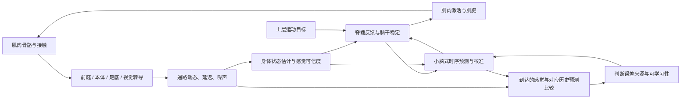

# 人体感觉—运动闭环与小脑研究路线

调研日期：2026-10-23。本文区分代码现状、已有研究和待验证方案；没有将建议描述为已经实现或证明有效的功能。当前代码核对不构成新的物理测试。

后续实现进展：已新增可切换的感觉站立、感觉驱动行走、身体状态估计与头眼稳定实验（[感觉行走](sensory-walking.md)），见 [实现与验收说明](sensory-control.md)。下表保留调研时原控制器的快照；新模式的视觉和本体感觉仍采用明确标注的代理，另已增加 [神经肌肉实验](neuromuscular-control.md) 的踝／全腿肌肉和物理眼球；完整生理神经回路仍待开发。

## 当前实现到什么程度

目前是**有在线误差校准的工程步行控制器**，实现了部分小脑相关功能，没有建立人体小脑神经回路。

| 已有部分 | 代码证据 | 实际范围 |
| --- | --- | --- |
| 重复侧推适应 | [Cerebellum.ts](../src/human/Cerebellum.ts) | 按实验时间分箱学习前馈修正；另有短期速度残差预测器。依赖重复提示，不能提前知道随机推力。 |
| 落脚时间学习 | [WalkingCerebellum.ts](../src/human/WalkingCerebellum.ts) | 左右脚、三个速度区间分别估计延迟，限幅修正摆腿时长。属于低维校准。 |
| 足底载荷学习 | [WalkingLoadLearning.ts](../src/human/WalkingLoadLearning.ts) | 按脚、速度、支撑阶段和时间分箱预测载荷残差；用阶段平均偏差小幅调整蹬离角及重心参考。不是完整的身体前向模型。 |
| 足底滚动、落点反馈 | [FootRocker.ts](../src/human/FootRocker.ts)、[NaturalWalking.ts](../src/human/NaturalWalking.ts) | 基本滚动轨迹由程序设定；落点反馈来自 capture point。并非整套步态由小脑自行学出。 |
| 肌肉与肌腱 | [MuscleController.ts](../src/human/MuscleController.ts) | 只有双肘四个原生肌肉执行器，默认关闭；腿部仍由位置电机驱动。皮肤和肌肉外形不代表相应生理执行系统。 |
| 感觉与视觉 | [LocomotionSensors.ts](../src/human/LocomotionSensors.ts)、[CorrectiveSkin.ts](../src/rendering/CorrectiveSkin.ts) | 读取精确质心、脚部世界坐标和接触力；眼睛朝给定世界目标转动属于显示控制，没有图像感知闭环。 |

关键缺口还存在于 [BalanceController.ts](../src/human/BalanceController.ts)：直接使用真实 `qpos/qvel`、质心、偏置力及当前状态质量矩阵。即使新增一个带噪声的感官面板，只要这里仍读取真值，就不能称为由感官维持平衡。

此前的连续行走与回归通过说明工程控制可运行，不能据此给出生理真实性百分比，也不能把载荷预测误差降低解释为自然度、物理载荷误差或代谢能耗必然改善。

## 别人已经做了什么

| 工作 | 已有贡献与边界 | 本项目可借鉴的内容 |
| --- | --- | --- |
| Fleischmann 等，JNER，2025-11：[小脑模型与分带跑步机适应](https://link.springer.com/article/10.1186/s12984-025-01818-2) | 把误差学习接到反射驱动的肌肉骨骼模型，只调整双腿起摆时机；能产生部分适应，空间适应仍不完整。 | 这是最接近当前任务的比较对象；“小脑学习步态时序”已有先例。作者注明代码和数据在 [SimTK](https://simtk.org/projects/splitbelt)，本次该仓库访问返回 403，未检查或复现其代码。 |
| Naveros 等：[iCub 上的脉冲小脑与前庭眼反射](https://arxiv.org/abs/2003.01409)（2020 年公开版本，关联期刊 DOI 见论文页） | 在真实机器人上实现头动时眼球补偿的适应，包含脉冲神经活动、可塑性和实时调度。任务是眼动，不能等同于全身行走。 | 先做一个可验证的头—眼感觉闭环，处理延迟与实时计算预算。 |
| Mitsuhashi 等，Neural Networks，2026-01：[多样复杂脉冲与运动预测](https://pubmed.ncbi.nlm.nih.gov/40845564/) | 用小鼠实验的复杂脉冲信号训练脉冲小脑，并与肌肉骨骼模型连接验证拉杆任务。 | 教学信号可以多样且具有时序结构；小鼠单项动作不能直接外推为人体全身控制。 |
| DBBS：[cerebellar-models / Brain Scaffold Builder](https://github.com/dbbs-lab/cerebellar-models) | 提供小脑皮层回路、形态与连接配置，支持 NEST / NEURON。 | 适合后续研究微回路；目前不能假定可直接装进浏览器实时控制人体。 |
| Song 与 Geyer，2015：[三维神经肌肉反射步行](https://physoc.onlinelibrary.wiley.com/doi/full/10.1113/JP270228) | 把肌肉、反馈回路和上层落脚控制结合起来。它不等于完整小脑模型。 | 脊髓反射和身体力学应成为底座，不能把所有快速稳定功能都归给小脑。 |
| [MyoSuite / MyoChallenge 2025 官方文档](https://myosuite.readthedocs.io/en/latest/challenge-doc2025.html) | 提供肌肉驱动的运动任务。其控制策略与生理神经机制需要分别判断。 | 参考肌肉模型、任务与训练接口；不能把动作表现好直接视为小脑机制正确。 |
| Filipe 等，2026-09：[皮层—小脑回路中的误差与预测学习](https://arxiv.org/abs/2609.29945) | 预印本探索延迟反馈下的多信号预测与内部反馈；本次未复现实验。 | 延迟补偿和多信号预测已有相关工作，不能单独作为首创依据。 |

## 必须对应人体的哪些结构

### 感觉输入

| 人体结构 | 应模拟的信号 | 对控制的作用与限制 |
| --- | --- | --- |
| 内耳半规管、耳石器 | 头坐标系的旋转信号、重力与线加速度合成信号，以及受体动态 | 估计头和身体朝向；耳石信号本身无法唯一分清倾斜与平移，必须结合其他信息。不能直接给控制器真实世界姿态。 |
| 肌梭及相关传入 | 肌肉长度、伸长速度，以及受激活调制的响应 | 本体感觉不是一个完美的关节角度表。只有关节状态时应明确标为代理信号。 |
| 腱器官及相关传入 | 肌腱张力的感觉近似 | 与肌梭结合估计承重和肌肉工作状态；不能简单把接触力当成每条肌腱的力。 |
| 足底皮肤机械感受器 | 足跟、跖骨区和趾部的分布接触、压力变化与剪切线索 | 判断承重转移、接触与滑移；压力中心应由分布感觉估计。 |
| 眼睛及眼动系统 | 头部视点的图像运动、目标相对方向、可用时的深度线索 | 稳定视线、判断自身移动与前方落脚区域；观察者的第三人称相机不算人物视觉。 |

这些选择的依据包括：倾斜 / 平移判别的[原始前庭研究](https://www.nature.com/articles/nature02754)、[人体肌梭记录](https://pubmed.ncbi.nlm.nih.gov/25297092/)、[足底刺激与平衡实验](https://pubmed.ncbi.nlm.nih.gov/11278108/)，以及视觉、前庭、本体感觉之间的[人体感觉重加权实验](https://pubmed.ncbi.nlm.nih.gov/12205132/)。不同实验、身体部位和通路的延迟不同，后续参数必须记录来源；工程压力测试的延迟数值不应冒称人体固定生理常数。

### 运动执行与神经通路

先从踝部的比目鱼肌、腓肠肌、胫前肌及跟腱入手，再扩展髋膝与侧向稳定肌。腓肠肌跨膝和踝，不能用一个单关节电机替代后就声称同等生理结构；肌腱弹性、激活动态、力臂、被动组织和关节轴也必须参与验证。

控制分层应区分：脊髓的相位相关快速反馈，脑干的姿态 / 头眼稳定，上层任务目标，以及小脑的预测与校准。小脑功能分区可启发模块划分，但并非一个软件模块等于一个脑区。[2024 年猕猴实验](https://www.nature.com/articles/s41467-024-48376-0)直接支持小脑结合运动与感觉信息、区分预期自身运动和意外运动这一方向；其结果不能直接证明我们提出的人体软件架构。

若后续加入神经网络，可将感觉和运动指令副本映射为苔藓纤维输入，以颗粒细胞式的时序特征编码上下文，以浦肯野细胞及核团式模块生成校正，并用攀缘纤维启发的教学事件更新可塑性。必须注明抽象层次，并通过对照证明这些约束有用，不能仅把普通网络的层重新命名。

## 下一步的具体开发顺序

1. **建立感觉接口与真值隔离。** 增加包含采样时刻、延迟、噪声、坐标系、有效性和置信度的感觉帧；先提供足底分布、本体感觉代理与头部前庭近似。真实物理状态只供感觉转导、渲染和评价使用。保留现有工程模式作为独立对照。
2. **加入身体状态估计。** 融合各感觉源和运动指令副本，输出估计姿态、速度、承重与不确定性。生理实验模式的力学预测须在独立数据中根据估计状态计算，不能绕回当前真实质量矩阵、偏置力和真实质心。单纯给原有控制器输入加噪声不够。
3. **闭合头—眼—身体回路。** 添加身体视点视觉、头部稳定和前庭眼反射校准。先验证转头时视线能否保持目标，再做视觉与前庭冲突；这是较小而可观察的实验。
4. **逐步替换踝部执行系统。** 用肌肉—肌腱和脊髓式反馈取代对应的位置伺服，保留与原模式的比较。检查踝部功率、跟腱储能、激活与受力，而不只看关节轨迹。
5. **扩展小脑预测。** 从预测单个载荷残差，扩展到预测延迟之后的多感官结果；利用这些结果校准反射、蹬地与落点。先做小型可解释模型，再考虑脉冲微回路和离线训练、实时推理。

建议的数据流如下。它是工程方案，不是人体完整神经解剖图。

## 可以研究的创新：先判断错在哪里，再决定学什么

候选问题是：**在具有感觉延迟和肌腱弹性的人体模型中，利用跨感官预测误差，能否区分短暂外力、持续身体改变和不可靠感官，从而避免把一次扰动学成长期动作偏差？**

- 单次推力：优先快速姿态和落脚反馈；不应无条件写入长期肌肉补偿。
- 持续负重或单侧肌力变化：多次一致的运动—感觉偏差支持更新身体模型和慢速记忆。
- 只有视觉场景异常运动：比较前庭、本体和足底证据，优先调整视觉可信度，避免错误学习“腿坏了”。

这三类原因可能不可辨，系统应表达不确定性并限制更新，而非保证每次都能正确分类。感觉重加权、主动运动预测、分布式可塑性和多时间尺度记忆均已有先例。例如[真实机器人分布式小脑学习](https://pmc.ncbi.nlm.nih.gov/articles/PMC4229206/)已经涉及多种学习机制。候选贡献是上述具体的人体耦合与误差归因实验；本次检索不能证明首创，也不构成专利检索。

## 怎样证明它有价值

设计单次侧推、持续负重 / 肌力变化、视觉流偏移、前庭偏差、感觉缺失与延迟等独立干预。扰动类型与发生时刻只交给实验器，控制器不能读取条件标签。第一阶段可以近似模拟感觉偏差，不能把简单角度偏置称为已复现真实肌梭振动。

在相同身体、训练预算、感觉条件和外力下比较：现有工程控制、带延迟感觉但无预测、加入感觉融合、加入预测学习、再加入误差来源判断。另做等参数量普通模型、固定学习率，以及去掉前庭 / 本体 / 足底 / 视觉通路的消融。多随机种子和未训练组合应报告分布，不只挑一段好看的录像。

主要指标是跌倒率、躯干 / 头部稳定、落点与滑移、地面反作用力、关节功率、肌肉激活、视网膜滑动、适应速度、撤去扰动后的后效应，以及错误写入长期记忆的程度。生理波形须与相近速度、体型和任务的人体数据比较。分带跑步机是一个已有的比较范式，但不能用“出现后效应”单独证明真实小脑机制。

下一次最有意义的演示应是：人物在感觉受限时仍能估计身体，转头时稳定视线，受推时调整一步，持续负重时逐步适应，而视觉错觉不会被错误记成永久腿部补偿。达到这些可测行为之后，才有充分理由讨论更大的神经回路。
